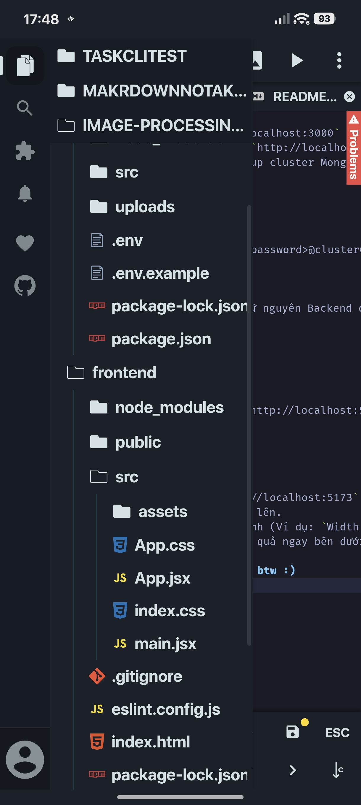

# 🖼️ Nền Tảng Xử Lý Ảnh Đám Mây (Full-Stack Image Processing)

Một ứng dụng web Full-Stack cho phép tải lên, lưu trữ và chỉnh sửa hình ảnh (cắt, xoay, đổi định dạng, lọc màu) theo thời gian thực. Dự án tập trung vào việc xây dựng một hệ thống Backend chịu tải cao và Frontend thân thiện với người dùng.

---

## 🎯 Mục tiêu & Bài toán giải quyết

Thay vì chỉ viết các API cơ bản, dự án này được thiết kế để giải quyết các vấn đề thực tế khi xây dựng một hệ thống xử lý file tĩnh (static files) với lượng truy cập lớn:

| Vấn đề thực tế (Pain Points) | Giải pháp của dự án (Solutions) | Lợi ích mang lại |
| :--- | :--- | :--- |
| **CPU Bottleneck:** Xử lý ảnh làm treo máy chủ Node.js (Block Event Loop). | Tích hợp engine **Sharp** (dựa trên C++). Xử lý ảnh đa luồng (Asynchronous). | Nhanh hơn 4-5 lần so với ImageMagick, máy chủ không bị đơ. |
| **Xử lý thừa thãi:** Người dùng bấm chỉnh sửa cùng 1 thông số nhiều lần. | Băm chuỗi thông số bằng thuật toán **MD5** để làm khóa Caching. | Thời gian phản hồi giảm từ hàng trăm ms xuống **0ms** khi lấy từ bộ nhớ. |
| **Tấn công cạn kiệt tài nguyên:** Spam request làm sập hệ thống. | Dùng **Rate Limiting** chặn theo IP và **Zod** xác thực dữ liệu đầu vào. | Hệ thống an toàn, từ chối ngay các file ảnh giả mạo. |
| **Hết dung lượng ổ cứng:** Lưu ảnh trực tiếp khiến Server nhanh đầy. | Hỗ trợ kiến trúc **Lưu trữ lai (Hybrid)** giữa ổ cứng (Local) và Đám mây. | Dễ dàng scale lên Cloudflare R2 hoặc AWS S3. |

---

## ⚙️ Cấu trúc hệ thống

Dự án gồm 2 module chính giao tiếp với nhau qua RESTful API:

*   **`backend`**: API Server (Node.js, Express, MongoDB, Sharp). Chịu trách nhiệm bảo mật, xử lý ảnh và lưu trữ.
*   **`frontend`**: Giao diện người dùng (React, Vite, Tailwind CSS). Cho phép tải ảnh lên và tinh chỉnh thông số trực quan.

---

## 🚀 Hướng dẫn Cài đặt & Khởi chạy

**Yêu cầu môi trường:** Đã cài sẵn `Node.js` (v18+) và `MongoDB` trên máy.
*(Lưu ý: Đảm bảo bạn đã điền đúng chuỗi kết nối Database vào file `.env` ở Backend trước khi chạy)*

### 1. Khởi chạy Backend (Server)

Mở Terminal và chạy các lệnh sau:

```bash
cd backend
npm install
npm run dev
```
*   Server API chạy tại: `http://localhost:3000`
*   Giao diện test API (Swagger): `http://localhost:3000/api-docs`
*   À quên! Nhớ tạo tài khoản, setup cluster MongoDB các kiểu. Sau đó tạo file .env trong folder ~/backend và thêm/chỉnh sửa phần dưới này vào nha :))
```
PORT=3000
BASE_URL=http://localhost:3000

# MONGODB_URI connection
MONGODB_URI=mongodb+srv://<user>:<password>@cluster0.5ehqehi.mongodb.net/image_service
```
### 2. Khởi chạy Frontend (Client)

Mở một cửa sổ Terminal **mới**, giữ nguyên Backend đang chạy:

```bash
cd frontend
npm install
npm run dev
```
*   Giao diện ứng dụng chạy tại: `http://localhost:5173`

---

## 🛠️ Hướng dẫn sử dụng nhanh

1. Mở trình duyệt, truy cập `http://localhost:5173`.
2. Tải một bức ảnh gốc từ máy tính lên.
3. Nhập các thông số muốn tinh chỉnh (Ví dụ: `Width: 800`, `Rotate: 90`, Format: `WebP`).
4. Bấm **Biến đổi ảnh** và xem kết quả ngay bên dưới, kèm link tải về.

## 🥂 I also do this sh*t on my phone btw 🤌
